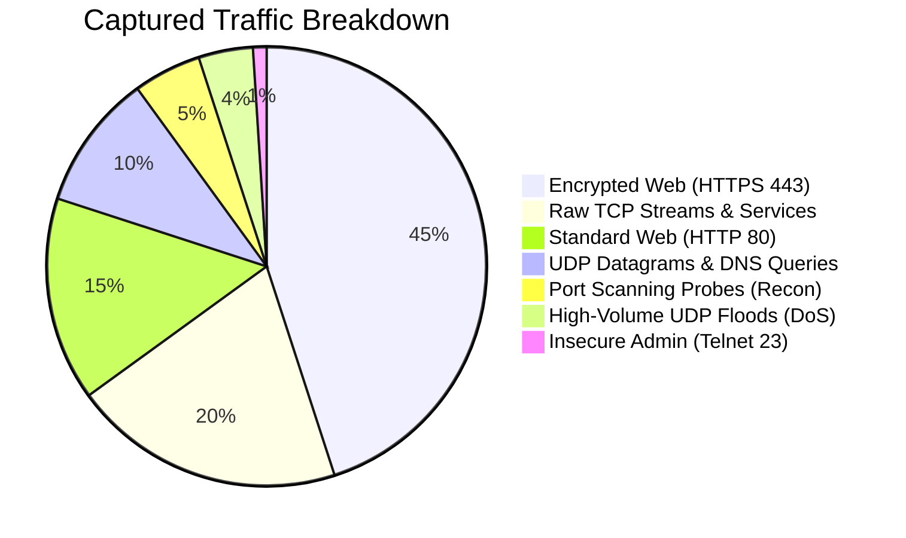
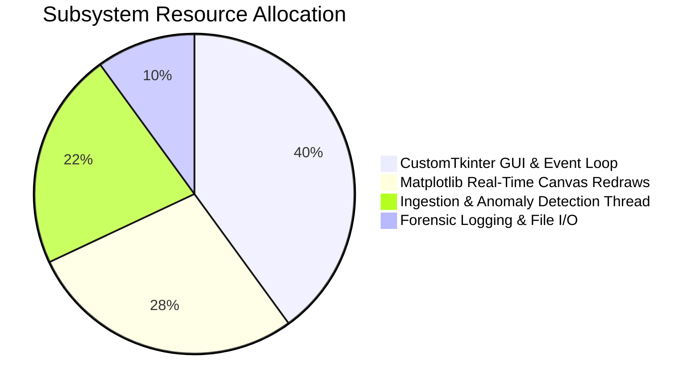
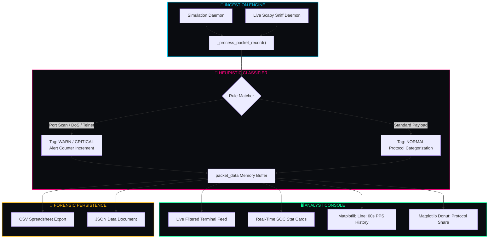

<div align="center">

<h1 style="font-family: 'Cooper Black', 'Arial Black', serif; font-size: 4rem; letter-spacing: 2px; color: #00ff99; margin-bottom: 2px; text-shadow: 0 0 25px rgba(0, 255, 153, 0.45);">
  🛡️ CYBERSENTINAL 🛡️
</h1>

<h3 style="font-family: 'Bookman Old Style', 'URW Bookman', 'Georgia', serif; font-weight: 500; color: #00d4ff; margin-top: 6px; letter-spacing: 0.8px;">
  ◈ <i>Next-Gen Network Threat & SOC Anomaly Analyzer</i> ◈
</h3>

<br/>

[](https://python.org)
[](https://github.com/TomSchimansky/CustomTkinter)
[](https://matplotlib.org/)
[](https://scapy.net/)
[](#)
[](LICENSE)

<br/>

<p align="center" style="font-family: 'Bookman Old Style', 'URW Bookman', serif; font-size: 1.05rem;">
  <b>✦ <a href="#01-system-overview">Overview</a> ✦</b> &nbsp;•&nbsp;
  <b>✦ <a href="#02-soc-console-preview">Console Preview</a> ✦</b> &nbsp;•&nbsp;
  <b>✦ <a href="#03-traffic-telemetry--metrics">Telemetry Charts</a> ✦</b> &nbsp;•&nbsp;
  <b>✦ <a href="#04-threat-detection-heuristics">Detection Rules</a> ✦</b> &nbsp;•&nbsp;
  <b>✦ <a href="#05-system-architecture">Architecture</a> ✦</b> &nbsp;•&nbsp;
  <b>✦ <a href="#06-installation--quick-start">Quick Start</a> ✦</b> &nbsp;•&nbsp;
  <b>✦ <a href="#07-forensic-export-formats">Data Export</a> ✦</b>
</p>

---

</div>

<h2 id="01-system-overview" style="font-family: 'Bookman Old Style', 'URW Bookman', 'Georgia', serif; color: #00ff99;">🌌 01. System Overview</h2>

<p style="font-family: 'Bookman Old Style', 'URW Bookman', serif; font-size: 1.05rem; line-height: 1.7;">
<b>CyberSentinal</b> is a high-performance desktop Security Operations Center (SOC) analyzer engineered for real-time packet inspection, threat classification, and network anomaly visualization. Powered by <b>CustomTkinter</b> and <b>Matplotlib</b>, it unifies non-blocking packet ingestion with continuous telemetry graphing and structured forensic logging into a cohesive, dark cyberpunk analyst terminal.
</p>

```
  ┌─────────────────────────┐      ┌─────────────────────────┐      ┌─────────────────────────┐
  │  📡 Ingestion Daemon    │ ──❯  │ 🧠 Heuristics Engine   │ ──❯  │ 🖥️ Dual-Chart SOC HUD   │
  │   (Simulated / Scapy)   │      │   Port Scan / DoS / Tel │      │    (PPS + Protocol Pie) │
  └─────────────────────────┘      └─────────────────────────┘      └─────────────────────────┘
```

> [!NOTE]
> **Dual Engine Architecture**: CyberSentinal runs in **Simulation Mode** (generating realistic benign corporate flows and adversarial attack vectors) or in **Live Mode** using Scapy network interface hooks.

---

<h2 id="02-soc-console-preview" style="font-family: 'Bookman Old Style', 'URW Bookman', 'Georgia', serif; color: #00ff99;">📸 02. SOC Console Preview</h2>

<div align="center">

<kbd>
  
</kbd>

<br/>
<sub style="font-family: 'Bookman Old Style', 'URW Bookman', serif;"><b>◈ Figure 1.0:</b> Real-time CyberSentinal HUD featuring live traffic terminal, rolling PPS line chart, and protocol breakdown donut chart.</sub>

</div>

---

<h2 id="03-traffic-telemetry--metrics" style="font-family: 'Bookman Old Style', 'URW Bookman', 'Georgia', serif; color: #00ff99;">📊 03. Traffic Telemetry & Metrics</h2>

### 🥧 Network Ingress Composition & Attack Signatures


### 🛰️ Subsystem Execution Profile


---

<h2 id="04-threat-detection-heuristics" style="font-family: 'Bookman Old Style', 'URW Bookman', 'Georgia', serif; color: #00ff99;">⚡ 04. Threat Detection Heuristics</h2>

<p style="font-family: 'Bookman Old Style', 'URW Bookman', serif; font-size: 1.02rem;">
Incoming packets are evaluated across dedicated rule sets in real time:
</p>

| Threat Class | Trigger Condition | Severity Level | Target Indicators / Ports | Live HUD Tag |
| :--- | :--- | :---: | :--- | :--- |
| **Port Reconnaissance** | Multi-port scanning sequence | <span style="color:#ff3366"><b>CRITICAL</b></span> | Ports `21, 22, 23, 80, 443, 445, 3389, 8080, 4444` | `● PORT SCAN PROBE` |
| **DoS / UDP Flood** | High-volume burst (>1200 Bytes) | <span style="color:#ffb703"><b>WARN</b></span> | Source: Suspicious C2 (`45.33.32.156`) | `▲ UDP BURST (FLOOD)` |
| **Cleartext Protocol** | Unencrypted administrative session | <span style="color:#ffb703"><b>WARN</b></span> | Destination: Telnet Port `23` (`10.0.4.88`) | `▲ INSECURE TELNET` |
| **Traffic Volumetrics** | Sustained rate exceeding 25 PPS | <span style="color:#00d4ff"><b>ELEVATED</b></span> | Network bandwidth spike | `◆ HIGH VOLUME` |
| **Benign Telemetry** | Verified DNS, TLS, and web streams | <span style="color:#00ff99"><b>NORMAL</b></span> | Certified CDNs & internal hosts | `✔ Routine Transmission` |

---

<h2 id="05-system-architecture" style="font-family: 'Bookman Old Style', 'URW Bookman', 'Georgia', serif; color: #00ff99;">🧬 05. System Architecture</h2>



---

<h2 id="06-installation--quick-start" style="font-family: 'Bookman Old Style', 'URW Bookman', 'Georgia', serif; color: #00ff99;">🚀 06. Installation & Quick Start</h2>

### 📋 Prerequisites
- **Python 3.8+**
- Operating System: Windows / Linux / macOS
- Network permissions (required only for Live Scapy Sniff mode)

### 🔧 Setup & Execution

```bash
# 1. Clone the repository
git clone https://github.com/<your-username>/CyberSentinal.git
cd CyberSentinal

# 2. Install required GUI and graphing libraries
pip install customtkinter matplotlib

# 3. (Optional) Install Scapy for live network interface capture
pip install scapy

# 4. Launch the application
python CyberSentinal.py
```

---

<h2 id="07-forensic-export-formats" style="font-family: 'Bookman Old Style', 'URW Bookman', 'Georgia', serif; color: #00ff99;">💾 07. Forensic Export Formats</h2>

<details open>
<summary><b>📄 JSON Data Document (<code>CyberSentinal_Log_*.json</code>)</b></summary>

```json
[
  {
    "timestamp": "12:05:42",
    "protocol": "TCP",
    "source": "185.220.101.5 (Tor Exit Node)",
    "destination": "192.168.1.15",
    "src_port": 51234,
    "dst_port": 4444,
    "size_bytes": 64,
    "threat_tag": "CRITICAL",
    "info": "PORT SCAN PROBE -> Port 4444"
  }
]
```
</details>

<details>
<summary><b>📊 CSV Spreadsheet Format (<code>CyberSentinal_Log_*.csv</code>)</b></summary>

```csv
Timestamp,Protocol,Source,Destination,Src_Port,Dst_Port,Size_Bytes,Threat_Level,Info
12:05:42,TCP,185.220.101.5 (Tor Exit Node),192.168.1.15,51234,4444,64,CRITICAL,PORT SCAN PROBE -> Port 4444
```
</details>

---

<h2 id="08-ethical-disclosure" style="font-family: 'Bookman Old Style', 'URW Bookman', 'Georgia', serif; color: #00ff99;">🛡️ 08. Ethical Disclosure</h2>

> [!CAUTION]
> **FOR AUTHORIZED SECURITY AUDITING & RESEARCH ONLY.**  
> CyberSentinal is intended exclusively for educational demonstrations, self-monitoring, and authorized network analysis. Unauthorized packet inspection on third-party networks without explicit consent violates applicable privacy and cybersecurity statutes.

---

<h2 id="09-license" style="font-family: 'Bookman Old Style', 'URW Bookman', 'Georgia', serif; color: #00ff99;">📜 09. License</h2>

Distributed under the **[MIT License](LICENSE)**.

<div align="center">

---

⭐ **Star this repository if you find CyberSentinal valuable for your security research!** ⭐

<p style="font-family: 'Bookman Old Style', 'URW Bookman', serif; color: #64748b; margin-top: 8px;">
  Crafted with 🛡️ by <b>Priyanshu Pundir</b>
</p>

</div>
