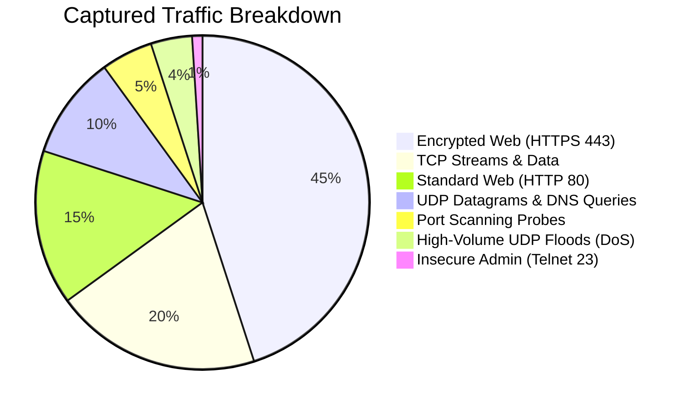
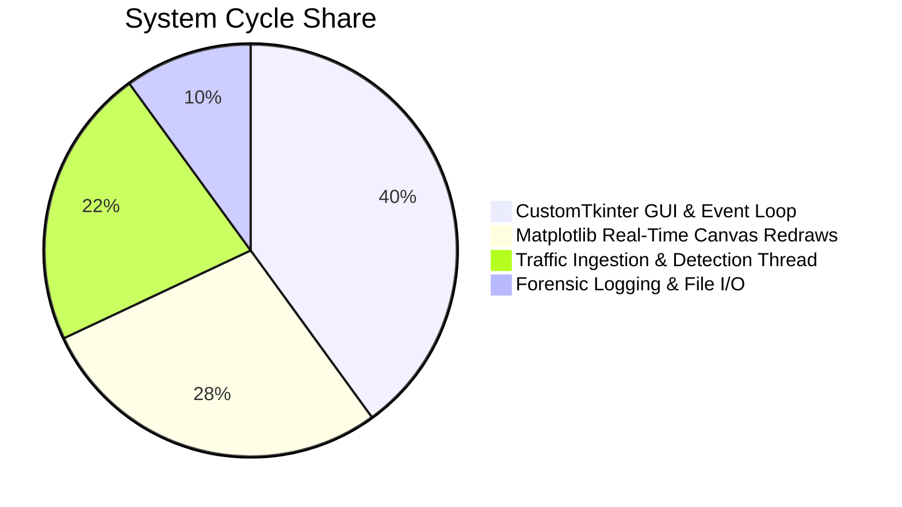
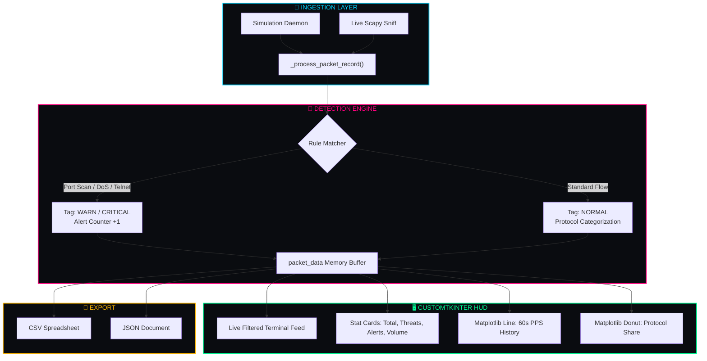

<div style="font-family: 'Bookman Old Style', 'URW Bookman', 'Bookman', 'Georgia', serif; color: #e2e8f0;">

<div align="center">

<h1 style="font-family: 'Cooper Black', 'Arial Black', serif; font-size: 4.5rem; letter-spacing: 1.5px; color: #00ff99; margin-bottom: 0px; text-shadow: 0 0 20px rgba(0,255,153,0.4);">
  🛡️ CYBERSENTINAL 🛡️
</h1>
<h3 style="font-family: 'Bookman Old Style', 'URW Bookman', serif; font-weight: normal; color: #00d4ff; margin-top: 4px;">
  ◈ <i> Next-Gen Network Threat & SOC Anomaly Analyzer</i> ◈
</h3>

<br/>

[](https://python.org)
[](https://github.com/TomSchimansky/CustomTkinter)
[](https://matplotlib.org/)
[](https://scapy.net/)
[](#)
[](LICENSE)

<br/>

<p align="center" style="font-size: 1.05rem;">
  <b>✦ <a href="#-system-overview">Overview</a> ✦</b> &nbsp;•&nbsp;
  <b>✦ <a href="#-live-soc-preview">Console Preview</a> ✦</b> &nbsp;•&nbsp;
  <b>✦ <a href="#-telemetry--charts">Telemetry Charts</a> ✦</b> &nbsp;•&nbsp;
  <b>✦ <a href="#-detection-heuristics">Detection Rules</a> ✦</b> &nbsp;•&nbsp;
  <b>✦ <a href="#-architecture--flow">Architecture</a> ✦</b> &nbsp;•&nbsp;
  <b>✦ <a href="#-quick-start">Quick Start</a> ✦</b> &nbsp;•&nbsp;
  <b>✦ <a href="#-forensic-export">Data Export</a> ✦</b>
</p>

---

</div>

<h2 style="font-family: 'Bookman Old Style', 'URW Bookman', serif; color: #00ff99;">🌌 01. System Overview</h2>

<p>
<b>CyberSentinal</b> is a desktop Security Operations Center (SOC) network traffic monitor and anomaly detection system. It features a dark cyberpunk dashboard built with <b>CustomTkinter</b>, non-blocking packet ingestion, live <b>Matplotlib</b> visual telemetry (PPS graph and protocol donut), real-time rule-based threat classification, and one-click forensic log exports in CSV and JSON formats.
</p>

```
  ┌─────────────────────────┐      ┌─────────────────────────┐      ┌─────────────────────────┐
  │  📡 Packet Ingestion    │ ──❯  │ 🧠 Heuristic Classifier │ ──❯  │ 🖥️ Dual-Chart SOC HUD   │
  │   (Simulation / Scapy)  │      │   Port Scan / DoS / Tel │      │    (PPS + Protocol Pie) │
  └─────────────────────────┘      └─────────────────────────┘      └─────────────────────────┘
```

> [!NOTE]
> <b>Dual Engine Support</b>: Operates in standalone <b>Simulation Mode</b> (generating realistic internal/external traffic and multi-vector anomalies) or live <b>Scapy Mode</b> for real hardware interface packet sniffing.

---

<h2 style="font-family: 'Bookman Old Style', 'URW Bookman', serif; color: #00ff99;">📸 02. Live SOC Preview</h2>

<div align="center">

<kbd>
  
</kbd>

<br/>
<sub><b>◈ Figure 1.0:</b> Real-time CyberSentinal HUD with color-coded traffic terminal, PPS line chart, and protocol breakdown donut graph.</sub>

</div>

---

<h2 style="font-family: 'Bookman Old Style', 'URW Bookman', serif; color: #00ff99;">📊 03. Telemetry & Charts</h2>

### 🥧 Simulated Traffic & Threat Composition


### 🛰️ Subsystem Execution Profile


---

<h2 style="font-family: 'Bookman Old Style', 'URW Bookman', serif; color: #00ff99;">⚡ 04. Detection Heuristics</h2>

| Anomaly Class | Trigger Condition | Severity Level | Targeted Ports / Vectors | Visual Indicator |
| :--- | :--- | :---: | :--- | :--- |
| **Port Reconnaissance** | Multi-port scanning probe | <span style="color:#ff3366"><b>CRITICAL</b></span> | `21, 22, 23, 80, 443, 445, 3389, 8080, 4444` | `● PORT SCAN PROBE` |
| **DoS / UDP Flood** | High-volume burst (>1200 B) | <span style="color:#ffb703"><b>WARN</b></span> | Source: Suspicious C2 (`45.33.32.156`) | `▲ UDP BURST (FLOOD)` |
| **Cleartext Protocol** | Unencrypted remote admin | <span style="color:#ffb703"><b>WARN</b></span> | Telnet Port `23` (`10.0.4.88`) | `▲ INSECURE TELNET` |
| **Traffic Rate Spikes** | Sustained rate > 25 PPS | <span style="color:#00d4ff"><b>ELEVATED</b></span> | High network throughput | `◆ HIGH VOLUME` |
| **Benign Traffic** | Standard web & DNS queries | <span style="color:#00ff99"><b>NORMAL</b></span> | Certified internal & CDN endpoints | `✔ Routine Transmission` |

---

<h2 style="font-family: 'Bookman Old Style', 'URW Bookman', serif; color: #00ff99;">🧬 05. Architecture & Flow</h2>



---

<h2 style="font-family: 'Bookman Old Style', 'URW Bookman', serif; color: #00ff99;">🚀 06. Quick Start</h2>

### 📋 Prerequisites
- **Python 3.8+**
- Packages: `customtkinter`, `matplotlib`, `scapy` *(optional for live sniffing)*

### 🔧 Setup & Execution

```bash
# 1. Clone repository
git clone https://github.com/<your-username>/CyberSentinal.git
cd CyberSentinal

# 2. Install dependencies
pip install customtkinter matplotlib

# 3. (Optional) Install Scapy for live capture
pip install scapy

# 4. Launch the application
python CyberSentinal.py
```

---

<h2 style="font-family: 'Bookman Old Style', 'URW Bookman', serif; color: #00ff99;">💾 07. Forensic Export</h2>

<details open>
<summary><b>📄 JSON Export Schema (<code>CyberSentinal_Log_*.json</code>)</b></summary>

```json
[
  {
    "timestamp": "12:05:42",
    "protocol": "TCP",
    "source": "185.220.101.5 (Tor Exit Node)",
    "destination": "192.168.1.15",
    "src_port": 51234,
    "dst_port": 4444,
    "size_bytes": 64,
    "threat_tag": "CRITICAL",
    "info": "PORT SCAN PROBE -> Port 4444"
  }
]
```
</details>

<details>
<summary><b>📊 CSV Export Format (<code>CyberSentinal_Log_*.csv</code>)</b></summary>

```csv
Timestamp,Protocol,Source,Destination,Src_Port,Dst_Port,Size_Bytes,Threat_Level,Info
12:05:42,TCP,185.220.101.5 (Tor Exit Node),192.168.1.15,51234,4444,64,CRITICAL,PORT SCAN PROBE -> Port 4444
```
</details>

---

<h2 style="font-family: 'Bookman Old Style', 'URW Bookman', serif; color: #00ff99;">🛡️ 08. Ethical Disclaimer</h2>

> [!CAUTION]
> <b>Educational & Authorized Monitoring Only</b>: CyberSentinal is intended strictly for educational research and authorized network diagnostics. Unauthorized interception of packets on networks without explicit owner consent is prohibited.

---

<h2 style="font-family: 'Bookman Old Style', 'URW Bookman', serif; color: #00ff99;">📜 09. License</h2>

Released under the <b><a href="LICENSE" style="color: #00ff99;">MIT License</a></b>.

<div align="center">

---

⭐ <b>Star this project if you find CyberSentinal helpful!</b> ⭐

</div>

</div>
