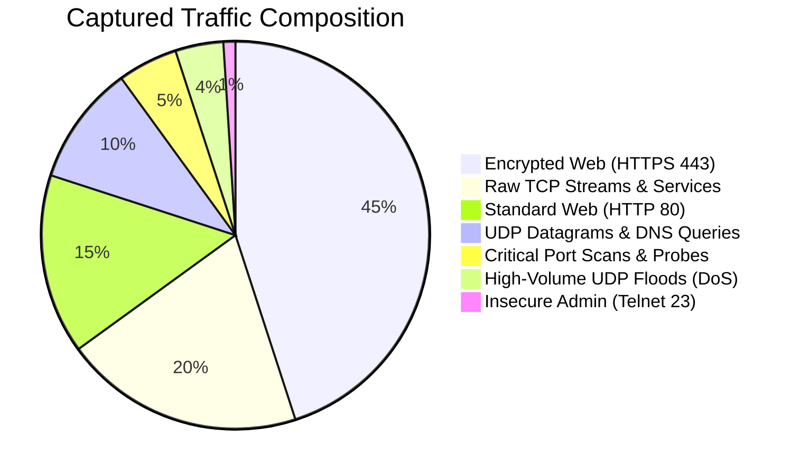
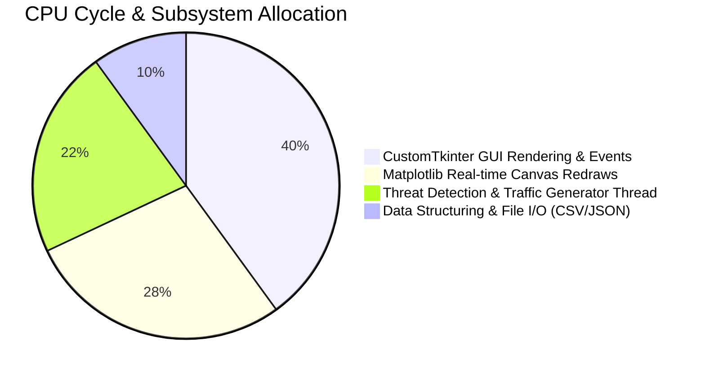
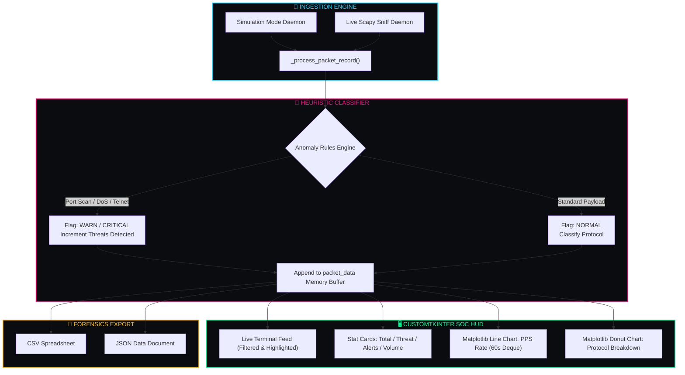

<div align="center">

# 🛡️ ℂ𝕐𝔹𝔼ℝ𝕊𝔼ℕ𝕋𝕀ℕ𝔸𝕃 🛡️
### ◈ `v2.0` // ℕ𝕖𝕩𝕥-𝔾𝕖𝕟 ℕ𝕖𝕥𝕨𝕠𝕣𝕜 𝕋𝕙𝕣𝕖𝕒𝕥 & 𝕊𝕆ℂ 𝔸𝕟𝕠𝕞𝕒𝕝𝕪 𝔸𝕟𝕒𝕝𝕪𝕫𝕖𝕣 ◈

<br/>

[](https://python.org)
[](https://github.com/TomSchimansky/CustomTkinter)
[](https://matplotlib.org/)
[](https://scapy.net/)
[](#)
[](LICENSE)

<br/>

<p align="center">
  <b>✦ <a href="#-overview--mission">Overview</a> ✦</b> &nbsp;•&nbsp;
  <b>✦ <a href="#-soc-terminal-preview">Terminal Preview</a> ✦</b> &nbsp;•&nbsp;
  <b>✦ <a href="#-threat-telemetry--charts">Telemetry Charts</a> ✦</b> &nbsp;•&nbsp;
  <b>✦ <a href="#-core-architecture--flow">Architecture</a> ✦</b> &nbsp;•&nbsp;
  <b>✦ <a href="#-anomaly-detection-matrix">Detection Rules</a> ✦</b> &nbsp;•&nbsp;
  <b>✦ <a href="#-quick-start--installation">Quick Start</a> ✦</b> &nbsp;•&nbsp;
  <b>✦ <a href="#-log-export-specification">Export Schemas</a> ✦</b>
</p>

---

</div>

## 🌌 01. 𝕆𝕧𝕖𝕣𝕧𝕚𝕖𝕨 & 𝕄𝕚𝕤𝕤𝕚𝕠𝕟

**CyberSentinal** is a desktop-native Security Operations Center (SOC) packet analysis and anomaly detection suite. Built with Python, CustomTkinter, and Matplotlib, it delivers a high-contrast dark cyberpunk HUD with real-time network event telemetry, multi-vector intrusion simulation, live PPS graphing, and forensic log export.

```
  ┌─────────────────────────┐      ┌─────────────────────────┐      ┌─────────────────────────┐
  │  📡 Packet Ingestion    │ ──❯  │ 🧠 Anomaly Detection    │ ──❯  │ 🖥️ Dual-Chart SOC HUD   │
  │   (Simulated / Scapy)   │      │    Heuristics Engine    │      │    (PPS + Protocol Pie) │
  └─────────────────────────┘      └─────────────────────────┘      └─────────────────────────┘
```

> [!NOTE]
> **Dual Engine Architecture**: CyberSentinal can run in **Simulation Mode** (generating realistic enterprise traffic, port scans, and DoS bursts) or **Live Sniff Mode** using native Scapy bindings.

---

## 📸 02. 𝕊𝕆ℂ 𝕋𝕖𝕣𝕞𝕚𝕟𝕒𝕝 ℙ𝕣𝕖𝕧𝕚𝕖𝕨

<div align="center">

<kbd>
  
</kbd>

<br/>
<sub><b>◈ Figure 1.0:</b> CyberSentinal Main Console — Live Traffic Terminal, Real-Time PPS Line Chart, Protocol Donut Graph, and Filter Bar.</sub>

</div>

---

## 📊 03. 𝕋𝕙𝕣𝕖𝕒𝕥 𝕋𝕖𝕝𝕖𝕞𝕖𝕥𝕣𝕪 & ℂ𝕙𝕒𝕣𝕥𝕤

### 🥧 Simulated Network Traffic & Threat Vector Breakdown


### 🛰️ Subsystem Execution Profile


---

## ⚡ 04. 𝔸𝕟𝕠𝕞𝕒𝕝𝕪 𝔻𝕖𝕥𝕖𝕔𝕥𝕚𝕠𝕟 𝕄𝕒𝕥𝕣𝕚𝕩

CyberSentinal classifies all ingress/egress records into real-time threat levels using dedicated heuristics:

| Anomaly Class | Trigger Condition | Threat Tag | Target / Indicator | Visual Log Output |
| :--- | :--- | :---: | :--- | :--- |
| **Port Scanning** | Multi-port reconnaissance probing | `CRITICAL` | Ports `21, 22, 23, 80, 443, 445, 3389, 8080, 4444` | <span style="color:#ff3366">● PORT SCAN PROBE -> Port X</span> |
| **DoS / UDP Flooding** | High-volume burst (>1200 Bytes) | `WARN` | Source: Suspicious C2 IP (`45.33.32.156`) | <span style="color:#ffb703">▲ HIGH VOLUME UDP BURST</span> |
| **Insecure Protocols** | Cleartext management traffic | `WARN` | Telnet Port `23` (`10.0.4.88`) | <span style="color:#ffb703">▲ INSECURE PROTOCOL (TELNET)</span> |
| **Traffic Rate Spikes** | Sustained packet rate > 25 PPS | `HIGH VOLUME` | High network throughput | <span style="color:#00d4ff">◆ HIGH TRAFFIC RATE</span> |
| **Benign Traffic** | Standard web, DNS, and TLS flows | `NORMAL` | Certified external CDNs & internal hosts | <span style="color:#00ff99">✔ Routine Payload Transmission</span> |

---

## 🧬 05. ℂ𝕠𝕣𝕖 𝔸𝕣𝕔𝕙𝕚𝕥𝕖𝕔𝕥𝕦𝕣𝕖 & 𝔽𝕝𝕠𝕨



---

## 🚀 06. ℚ𝕦𝕚𝕔𝕜 𝕊𝕥𝕒𝕣𝕥 & 𝕀𝕟𝕤𝕥𝕒𝕝𝕝𝕒𝕥𝕚𝕠𝕟

### 📋 Prerequisites
- **Python 3.8+**
- Standard OS network privileges (for live Scapy sniffing mode)

### 🔧 Installation

```bash
# 1. Clone repository
git clone https://github.com/<your-username>/CyberSentinal.git
cd CyberSentinal

# 2. Install required GUI and charting libraries
pip install customtkinter matplotlib

# 3. (Optional) Install Scapy for live packet sniffing
pip install scapy
```

### 🕹️ Execution

```bash
python CyberSentinal.py
```

---

## 🎛️ 07. ℂ𝕠𝕟𝕥𝕣𝕠𝕝𝕤 & 𝔽𝕚𝕝𝕥𝕖𝕣𝕚𝕟𝕘 𝔾𝕦𝕚𝕕𝕖

<details open>
<summary><b>🔍 Live Filter Bar & Search Engine</b></summary>

- **Text Search Box**: Instant real-time substring filtering across IP addresses, ports, protocol names, and log details.
- **Protocol Dropdown**: Filter visible terminal logs by `ALL`, `TCP`, `UDP`, `ICMP`, `HTTPS`, `HTTP`, `DNS`, or `THREATS ONLY`.
- **Auto-Scroll Checkbox**: Locks feed focus to the newest incoming packet.
- **🧹 Clear Button**: Empties visible terminal text buffer without resetting global metrics.
</details>

<details open>
<summary><b>🔄 Operations & Telemetry Actions</b></summary>

- **▶ INITIATE SCAN**: Boots background thread worker and initiates live packet stream.
- **⏹ TERMINATE**: Safely disengages scanner thread and pauses Matplotlib update loops.
- **💾 EXPORT LOGS**: Opens save dialog to dump full session history into `.csv` or `.json`.
- **🔄 RESET STATS**: Clears all internal historical deques, protocol counters, and visual charts.
</details>

---

## 💾 08. 𝕃𝕠𝕘 𝔼𝕩𝕡𝕠𝕣𝕥 𝕊𝕡𝕖𝕔𝕚𝕗𝕚𝕔𝕒𝕥𝕚𝕠𝕟

<details>
<summary><b>📄 JSON Export Schema Example (<code>CyberSentinal_Log_*.json</code>)</b></summary>

```json
[
  {
    "timestamp": "12:05:42",
    "protocol": "TCP",
    "source": "185.220.101.5 (Tor Exit Node)",
    "destination": "192.168.1.15",
    "src_port": 51234,
    "dst_port": 4444,
    "size_bytes": 64,
    "threat_tag": "CRITICAL",
    "info": "PORT SCAN PROBE -> Port 4444"
  }
]
```
</details>

<details>
<summary><b>📊 CSV Export Header Specification (<code>CyberSentinal_Log_*.csv</code>)</b></summary>

```csv
Timestamp,Protocol,Source,Destination,Src_Port,Dst_Port,Size_Bytes,Threat_Level,Info
12:05:42,TCP,185.220.101.5 (Tor Exit Node),192.168.1.15,51234,4444,64,CRITICAL,PORT SCAN PROBE -> Port 4444
```
</details>

---

## 🛡️ 09. 𝔼𝕥𝕙𝕚𝕔𝕒𝕝 𝔻𝕚𝕤𝕔𝕝𝕒𝕚𝕞𝕖𝕣

> [!CAUTION]
> **FOR AUTHORIZED SECURITY MONITORING & EDUCATIONAL PURPOSES ONLY.**  
> CyberSentinal is developed for network administrators, researchers, and students. Live packet sniffing must only be conducted on networks and devices you own or are explicitly authorized to audit.

---

## 📜 10. 𝕃𝕚𝕔𝕖𝕟𝕤𝕖

Distributed under the **[MIT License](LICENSE)**.

<div align="center">

---

⭐ **Star this repository if you found CyberSentinal useful!** ⭐

Crafted with 🛡️ by **Cyber Defense Research**

</div>
